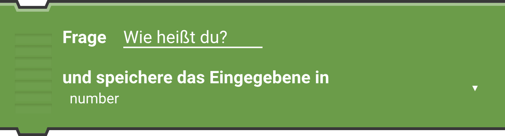

Der Baustein fordert dich mit einer Frage auf, eine Antwort zu geben und speichert deine Antwort in einer bestimmten Variablen. Es ist wie wenn man einem Publikum eine Frage stellt und ihre Antwort für spätere Verwendung im Skript speichert.
