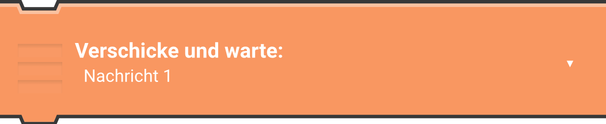

Sendet eine Nachricht an andere Teile deines Projekts und wartet dann, bis sie ihre Aufgaben abgeschlossen haben, bevor es weitergeht. Es ist wie wenn man einen Freund bittet, etwas zu tun, und darauf wartet, dass er fertig ist, bevor man fortfährt.

**Warum Broadcast-Nachrichten “Verschicke und warte” senden?**

Mit den Nachrichten können verschiedenen Objekten/Figuren innerhalb einer Szene kommunizieren und interagieren. Sie ermöglichen es einem Objekt, eine Nachricht an alle anderen Objekte zu senden, und die empfangenden Objekte können dann auf diese Nachricht reagieren oder antworten.

Diese Nachrichten werden **nicht** am Bildschirm **angezeigt**! Willst du Nachrichten anzeigen lassen, nütze die Blöcke der Kategorie “Aussehen”!

**Wie funktioniert das?**

- *Sender*: Das Senderobjekt startet die Kommunikation mit einem “Verschicke an alle” Block. Dieser Block wird verwendet, um eine Nachricht an alle anderen Objekte in der Szene (auch im Hintergrund) zu senden.
- *Empfänger*: Der/die Nachrichtenempfänger ist das Objekt/die Figur, das/die auf Nachrichten hört und darauf antwortet. Es/sie verwendet den “*Wenn du empfängst*“-Block, um zu erkennen, wann eine bestimmte Nachricht empfangen wird.
- Wenn das empfangende Objekt die Nachricht erhält, führt es alle Blöcke aus, die unter dem “*Wenn du empfängst*“-Block liegen. Dies erlaubt benutzerdefinierte Verhaltensweisen oder Aktionen beim Empfang einer bestimmten Nachricht.
