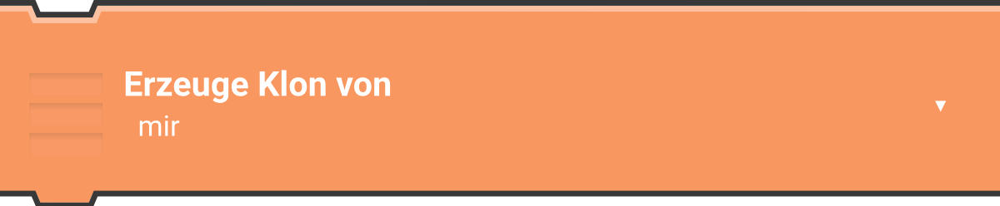

Dieser Baustein erstellt eine Kopie des spezifizierten Objekts, die als Klon bezeichnet wird und sich genauso verhält wie das Original. Stell dir vor, du duplizieren eine Figur oder ein Objekt im Spiel. Der Klon ist in der Lage, seine eigenen Aktionen und Skripte auszuführen, was es dir ermöglicht, mehrere Instanzen eines Objekts zu erstellen, die unabhängig voneinander agieren können.
