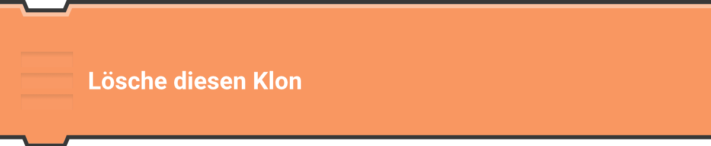

Dieser Baustein entfernt den Klon, der mit dem Baustein “Klon erstellen” erstellt wurde. Es ist, als würdest du sagen: “Entferne diesen Duplikat.” Verwende dies, um die Anzahl der Klone in deinem Projekt zu verwalten und zu kontrollieren, und stelle sicher, dass sie gelöscht werden, wenn sie nicht mehr benötigt werden.
