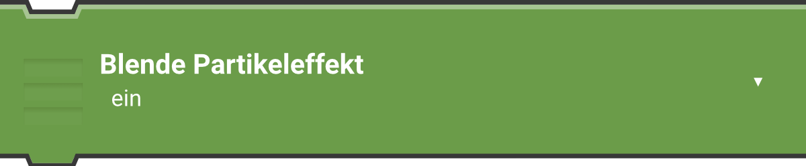

Dieser Baustein fügt deiner Figur Partikel hinzu und lässt sie im Laufe der Zeit allmählich verschwinden. Verwende es, um beispielsweise ein Feuerwerk zu erzeugen, Rauch hinzuzufügen oder deine Figur schnell erscheinen zu lassen.
