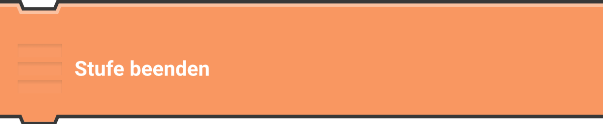

Dieser Baustein stoppt alle Skripte und beendet die aktuelle Bühne oder Szene. Es ist, als würde man sagen: “Dieser Teil des Projekts ist vorbei.” Alles stoppt und das Projekt kann entweder zu einer anderen Szene übergehen oder vollständig enden. Verwende dies, wenn du eine bestimmte Phase in deinem Projekt abschließen möchtest.
