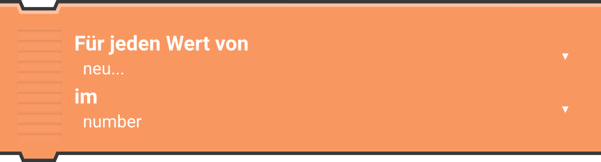

Dieser Baustein führt eine Reihe von Anweisungen für jedes Element in einer Liste aus. Es ist, als würde man jedes Element nacheinander durchgehen und dieselbe Aktion auf jedes ausführen.

Stell dir vor, du hast eine Liste von Zahlen, Farben oder anderen Elementen. Mit diesem Baustein hast du die wunderbare Möglichkeit, jedes Element aus der Liste individuell zu nutzen. Wenn du beispielsweise eine Liste von Farben hast und die Hintergrundfarbe entsprechend jeder Farbe in der Liste anpassen willst, dann ist genau dafür dieser Baustein gedacht.

Es ist, als würde man sagen: “Für jedes Element in dieser Gruppe diese Anweisungen ausführen”.
