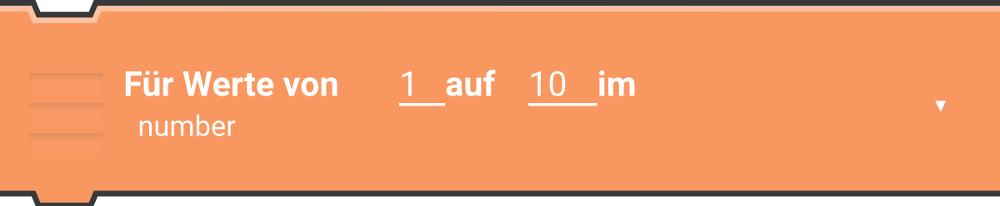

Dieser Block führt eine Reihe von Anweisungen eine bestimmte Anzahl von Malen aus und verwendet einen Zähler, der mit einem Wert beginnt und mit einem anderen endet. Es ist so, als würde man eine Schleife einrichten, bei der man genau weiß, wie oft sie ausgeführt werden soll.

Stelle dir vor, du hast eine Liste von Elementen und möchtest mit jedem etwas tun. Dieser Block ermöglicht es dir, jedes Element nacheinander zu durchlaufen und bei jedem dasselbe zu tun.
