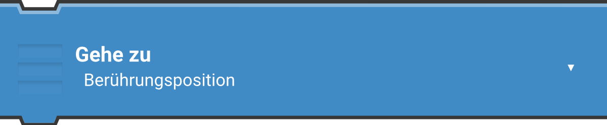

Bewege dein Objekt umgehend an die Stelle eines anderen Objekts, die Berührungsposition oder an eine zufällige Position. Denke daran, dass es ist, als würdest du sagen: “Gehe dorthin, wo dieser andere Charakter ist”, “Gehe an einen zufälligen Ort” oder “Gehe dorthin, wohin ich mit meinem Finger tippe”.
