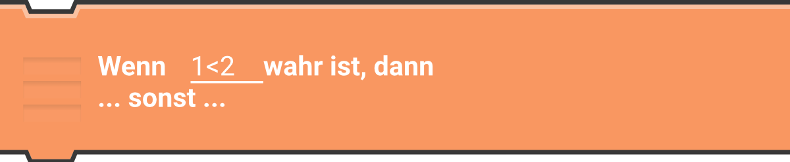

Überprüft, ob eine Bedingung wahr ist, und führt ein Set von Anweisungen aus. Wenn die Bedingung nicht wahr ist, wird ein anderes Set von Anweisungen ausgeführt. Es ist wie zwei Optionen anzubieten: “Wenn dies wahr ist, mache das; andernfalls mache das.”
