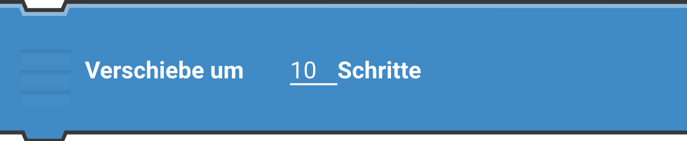

Bewegt das Objekt eine bestimmte Anzahl von Schritten in die Richtung, in die es gerade zeigt. Es ist, als würde man einem Charakter sagen, eine bestimmte Anzahl von Schritten nach vorne zu gehen. Wenn du den Emroidery Designer (für Stickmuster) benutzt, entsprechen 10 Schritte 2 mm (1 cm entspricht 50 Schritten).
