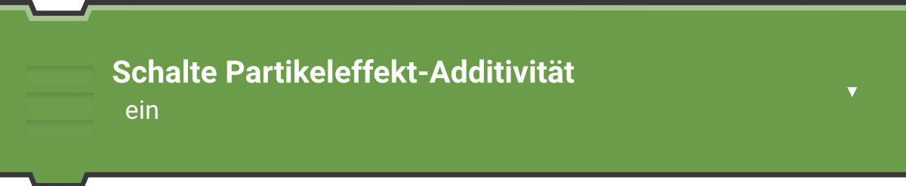

Dieser Baustein aktiviert oder deaktiviert den additiven Mischmodus für Partikel, der Partikel heller und intensiver erscheinen lassen kann. Es ist wie das Einstellen der Helligkeit und des Glanzes von Glitzern.
