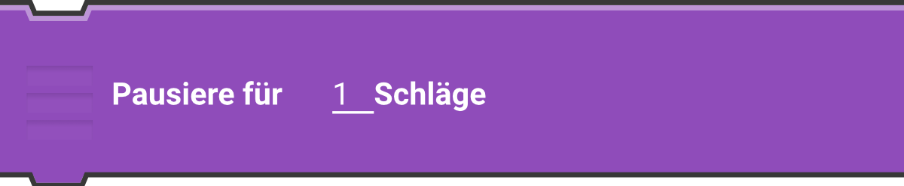

Dieser Baustein lässt das Skript eine bestimmte Anzahl von Takten warten, bevor es fortfährt. Es ist, als würde man eine kurze Pause in einem Lied einlegen, bevor man die nächste Note oder den nächsten Klang spielt. Stell dir vor, du hältst deine Aufführung einen Moment lang an, zählst die Takte und setzt dann die Handlung fort.
