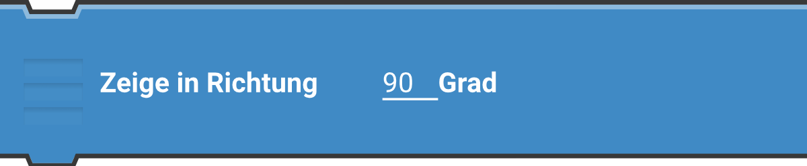

Setzt die Richtung, in die das Objekt zeigt, auf einen bestimmten Winkel. Es ist, als würdest du deinem Objekt anweisen, sich in eine bestimmte Richtung zu drehen, beispielsweise nach oben, unten, links oder rechts.
