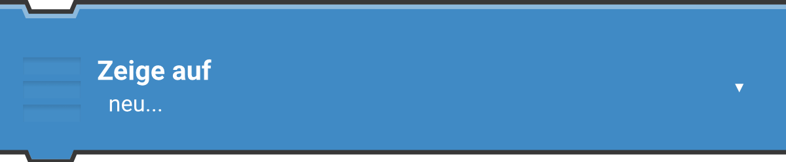

Stelle das Objekt so ein, dass es auf ein anderes Objekt oder den Mauszeiger gerichtet ist. Stell dir vor, du sagst deinem Charakter, immer auf ein bestimmtes Ziel oder in eine bestimmte Richtung zu schauen.
