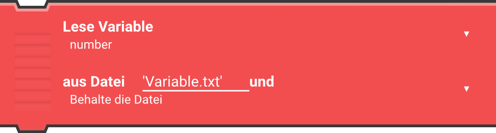

Lade eine zuvor gespeicherte Variable von deinem Gerät und entscheide, was mit der Datei passieren soll. Stelle dir vor, du öffnest eine Notiz, die du zuvor gespeichert hast, um ihren Inhalt zu überprüfen.
