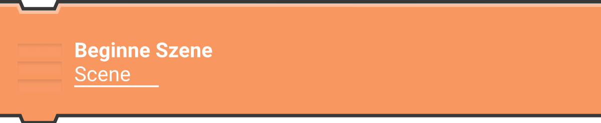

Mit diesem Baustein wechselst du zu einer anderen Szene im Projekt und beginnst, diese Szene von Anfang an auszuführen. Dieser Baustein wird verwendet, um zum nächsten Level in einem Spiel zu gelangen, ein Game Over einzuführen oder einen Willkommen-Bildschirm.

Stell dir vo, dass du mehrere Szenen in deinem Projekt hast, die jeweils einen anderen Teil deiner Geschichte oder deines Spiels repräsentieren. Mit diesem Baustein kannst du zu jeder Szene springen und sie von ganzem Anfang an starten, um einen reibungslosen Übergang zwischen den verschiedenen Teilen deines Projekts zu schaffen.
