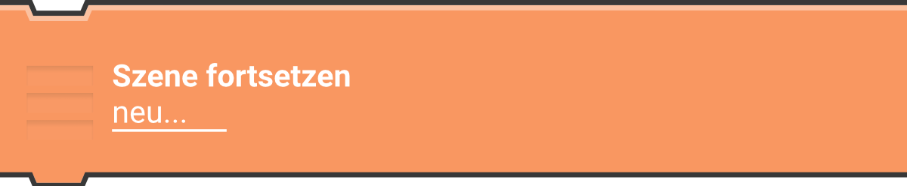

Dieser Baustein setzt die Szene dort fort, wo sie pausiert wurde. Wenn die Szene durch eine Pause oder Wartezeit unterbrochen wurde, wird mit diesem Baustein die Handlung genau dort wieder aufgenommen, wo sie aufgehört hat.

Stell dir vor, du hast ein Spiel oder eine Animation pausiert und möchtest sie nun weiterlaufen lassen. Dieser Klick dient als “Abspielen”-Button und lässt alles ab dem Punkt fortsetzen, an dem es pausiert wurde.
