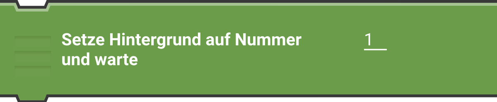

Der Baustein ändert den Hintergrund basierend auf seiner Position in der Liste der Hintergründe und wartet, bis die Änderung abgeschlossen ist, bevor das Skript fortgesetzt wird. Es ist, als würde man in einem Theaterstück die Szenerie zu einem bestimmten Hintergrund aus einer Liste wechseln und die Handlung anhalten, bis die neue Szene vollständig aufgebaut ist.
