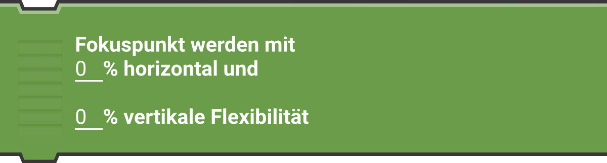

Der Baustein setzt die Figur als den Fokuspunkt des Bildschirms mit spezifischer Flexibilität in horizontaler und vertikaler Richtung. Es ist, als würdest du der Kamera sagen, einer Figur zu folgen, während gleichzeitig etwas Bewegung um das Zentrum herum erlaubt wird.
