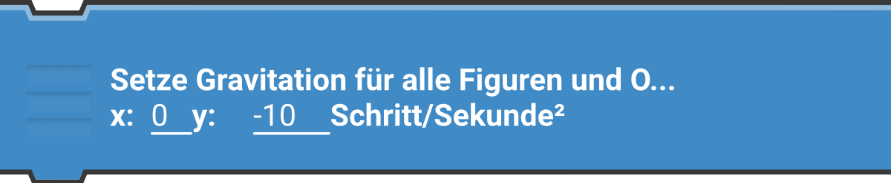

Passt die Schwerkraft an, die auf alle Objekte im Projekt angewendet wird. Es ist, als würdest du ändern, wie stark Dinge von der Schwerkraft nach unten oder zur Seite gezogen werden, was beeinflusst, wie sie fallen oder sich bewegen.
