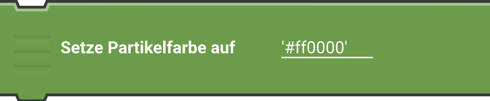

Dieser Baustein ändert die Farbe der Partikel, die von der Figur ausgestoßen werden.

Die Farbe wird durch einen Hexadeziamlfarbcode angegeben.

Ein Hexadezimalfarbcode ist eine Möglichkeit, Farben mithilfe von hexadezimalen Werten (0-9 und A-F) darzustellen. Er besteht aus sechs Zeichen. Der Code wird mit einem “#” am Anfang geschrieben und sieht so aus: `#RRGGBB`.

- Die ersten beiden Zeichen (“RR”) repräsentieren den roten Baustein der Farbe.
- Die nächsten beiden Zeichen (`GG`) stellen die Grün-Komponente dar.
- Die letzten beiden Zeichen (`BB`) repräsentieren die blaue Komponente.

Jedes Zeichenpaar kann von `00` (was keiner dieser Farben bedeutet) bis `FF` (was die maximale Menge dieser Farbe bedeutet) reichen. Zum Beispiel:

`#000000` ist schwarz (keine Farbe).

`#FF0000` = Rot.

`#00FF00` = Grün.

`#0000FF` = Blau.

`#FFFFFF ist weiß (maximal rot, grün und blau).`
