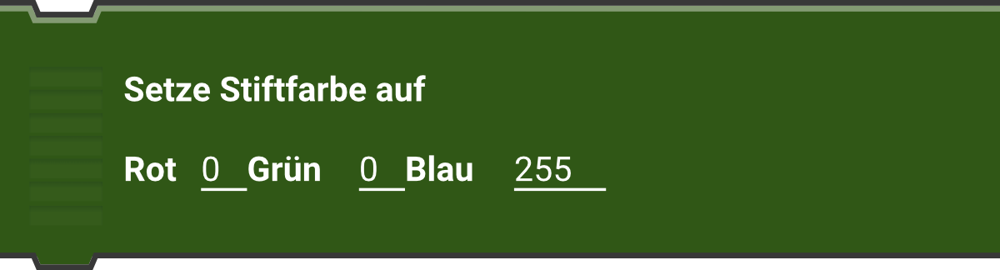

Der Baustein ändert die Farbe des von der Figur verwendeten Stifts. Es ist, als würde man beim Zeichnen auf einen Stift in einer anderen Farbe umsteigen.

**Rot, Grün, Blau (RGB)**: Das RGB-Farbmodell verwendet unterschiedliche Intensitäten von rotem, grünem und blauem Licht, um eine breite Palette von Farben zu erzeugen. Jede Farbkomponente (rot, grün und blau) kann einen Wert zwischen 0 und 255 haben:

- **Rot**: Der Rot-Anteil der Farbe. Ein höherer Wert bedeutet mehr Rot.
- **Grün:** Der Grün-Anteil der Farbe . Ein höherer Wert bedeutet mehr Grün.
- **Blue**: Der Blau-Anteil der Farbe. Ein höherer Wert bedeutet mehr Blau.

Durch die Kombination verschiedener Werte für Rot, Grün und Blau kannst du jede Farbe erstellen. Zum Beispiel:

- `RGB(255, 0, 0)` ist reines Rot.
- `RGB(0, 255, 0)` ist reines Grün.
- `RGB(0, 0, 255)` ist reines Blau.
- `RGB(255, 255, 255)` ist weiß (maximal Rot, Grün und Blau).
- `RGB(0, 0, 0)` ist schwarz (keine Farbe).

Das Mixen dieser Farben in verschiedenen Mengen erzeugt alle Farben, die du auf digitalen Bildschirmen siehst.
