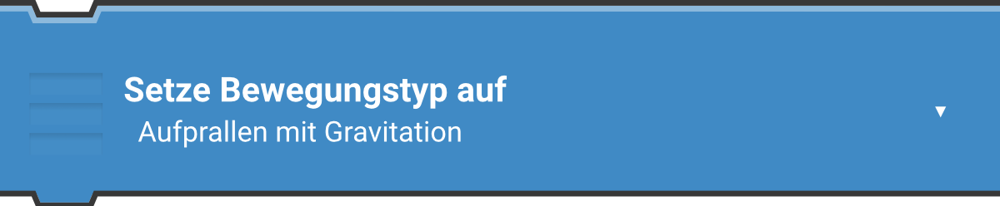

Ändert die Art und Weise, wie sich das Objekt bewegt, zum Beispiel bewegt sich das Objekt unter Einfluss der Schwerkraft oder eben nicht unter der Schwerkraft, während andere von ihm abprallen.

Mit dem Baustein wählst du aus, wie sich dein Charakter in Bezug auf Bewegung und Interaktion mit anderen Objekten verhalten sollte.
