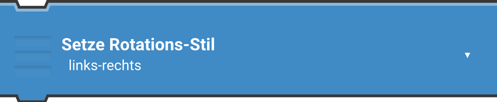

Ändere, wie sich das Objekt dreht (rundherum, nur links-rechts oder gar nicht drehen). Mit dem Baustein stellst du ein, ob sich deine Figur komplett herumdrehen kann, nur nach links und rechts schaut oder sich überhaupt nicht dreht.
