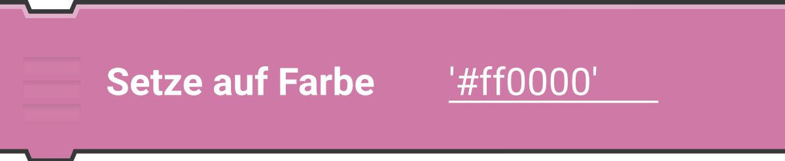

Mit diesem Baustein änderst du die Farbe deines Fadens für dein Stickprojekt. Die Farbe wird in deinem Programm angezeigt. Es bedeutet nicht, dass die Stickmaschine dann genau diese Farben verwendet.
