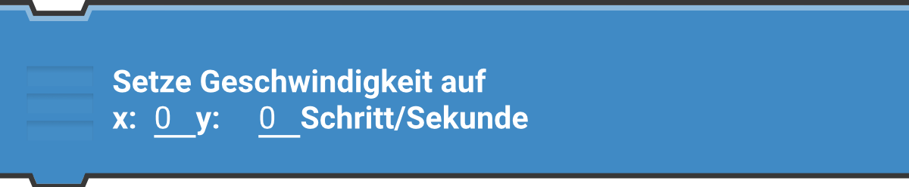

Mit diesem Baustein bestimmst du die Geschwindigkeit und Richtung, in der sich das Objekt bewegt. Es ist so, als würdest du deiner Figur gleich zu Beginn sagen, wie schnell sie gehen und in welche Richtung sie sich bewegen soll.
