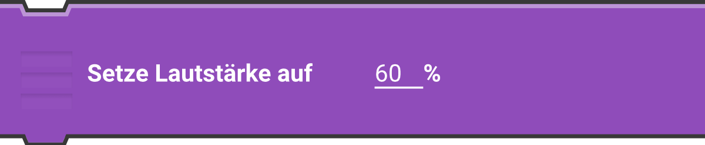

Der Baustein passt die Lautstärke aller Geräusche auf einen bestimmten Prozentsatz an. Es ist, als würdest du den Lautstärkeregler drehen, um einzustellen, wie laut oder leise die Geräusche sein sollen.
