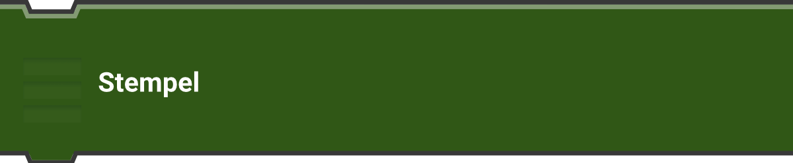

Mit diesem Baustein hinterlässt du eine Kopie des Aussehens deiner Figur am Bildschirm. Es ist, als würdest du einen eingefärbten Stempel auf Papier drücken und so eine Kopie des Stempeldesigns hinterlassen. Damit verschönerst du deinen Hintergrund – du erstellst keinen Klon!
