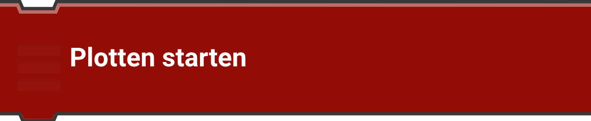

Dieser Baustein startet den Plotting-Prozess, während sich die Figur bewegt. Es ist, als ob du einen Malstift auf ein Papier setzt, um eine Linie zu ziehen. Du kannst den “Plot abschließen” Baustein verwenden, wenn du den Plot anhalten und die Figur an eine andere Stelle bewegen möchtest, um den Plot an einer anderen Stelle fortzuführen.
