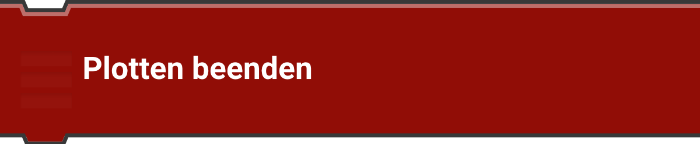

Der “Plotten beenden” Baustein pausiert den Plot Prozess und ermöglicht es dir, deine Figur an eine neue Position zu bewegen oder deinen Plot zu beenden. Es ist so, als würdest du einen Stift vom Papier abheben, um ihn neu zu positionieren oder aufzuhören zu zeichnen. Nachdem du mit dem Plotten fertig bist, kannst du den “Plot als SVG speichern” Baustein verwenden, um deinen Plot als SVG-Datei zu speichern.
