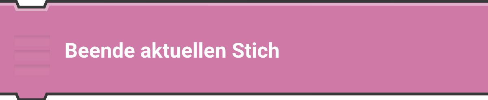

Mit diesem Baustein beendest du die aktuelle Stichart. Du benötigst diesen Baustein, wenn du die Position der Nadel ändern möchtest, nachdem du mit einem Gerad-, Zickzack- oder Dreifachstich begonnen hast.
