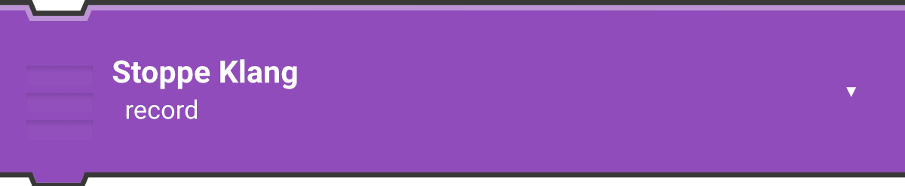

Dieser Baustein stoppt das Abspielen eines bestimmten Sounds. Es ist, als würde man die Stopp-Taste nur für ein Lied drücken, während andere Geräusche oder Musik weiter abgespielt werden. Mit dem Baustein sagst du deiner Figur, dass sie das Abspielen eines bestimmten Soundtracks stoppen soll.
