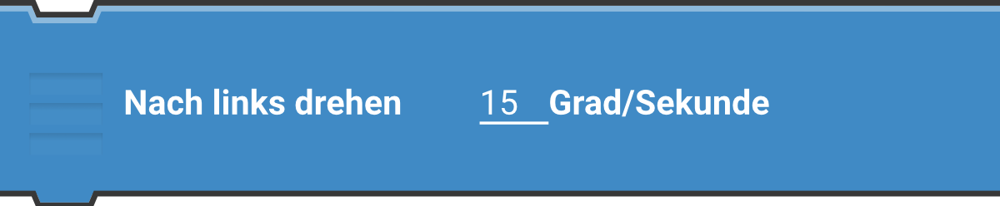

Mit diesem Baustein dreht sich dein Objekt um eine bestimmte Anzahl an Grad pro Sekunde nach links. Es ist wie das Drehen deines Charakters an Ort und Stelle in einer gegen den Uhrzeigersinn gerichteten Richtung.
