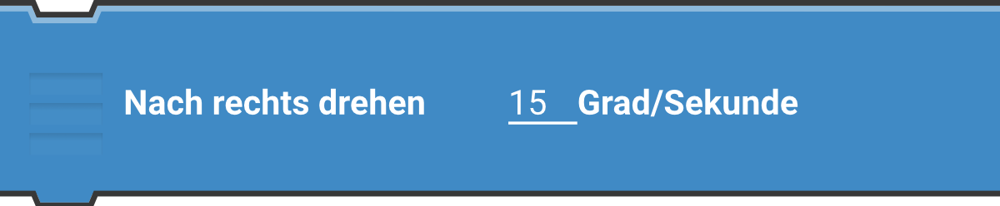

Mit diesem Baustein dreht sich dein Objekt um eine bestimmte Anzahl an Grad pro Sekunde nach rechts. Es ist wie das Drehen deines Charakters an Ort und Stelle in einer im Uhrzeigersinn gerichteten Richtung.
