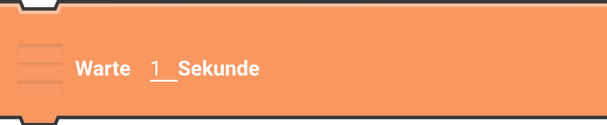

Verzögert das Skript für eine bestimmte Zeit, bevor es mit der nächsten Anweisung fortfährt. Stell dir vor, du stellst einen Timer ein und wartest, bis er klingelt, bevor mit der nächsten Aufgabe weitergemacht wird.
