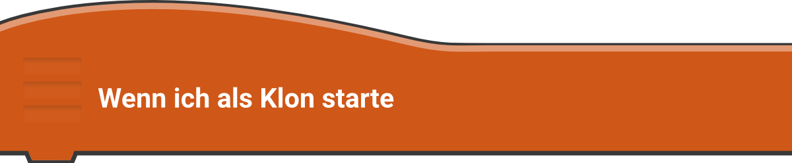

Weist einem erstellten Klon eines Objekts Anweisungen zu, um die gewünschten Aktionen auszuführen. Dieser Prozess ermöglicht es, die Funktionalität des Originalobjekts zu reproduzieren, während der Klon unabhängig von diesem gesteuert wird. Dabei können verschiedene Verhaltensweisen oder Eigenschaften des Klonobjekts festgelegt werden, um spezifische Anforderungen zu erfüllen.
