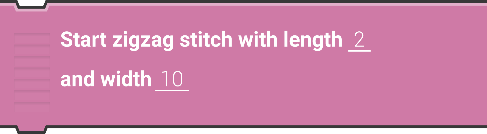

Σε αυτό το εκπαιδευτικό θα μάθεις όλα όσα χρειάζεται να ξέρεις για τα μπλοκ κεντήματος!

Δεν χρειάζεσαι καμία γνώση προγραμματισμού για αυτό.

Κάθε μπλοκ κεντήματος εξηγείται με ένα παράδειγμα.

Αν δεν έχεις ακόμα ενεργοποιήσει τα μπλοκ κεντήματος, δες το εκπαιδευτικό **[Ενεργοποίηση μπλοκ κεντήματος](../activate-embroidery-bricks.md)**.

*Εδώ μπορείς να κατεβάσεις το εκπαιδευτικό σε μορφή PDF*:

[Μπλοκ κεντήματος](../../../../media/embroidery-tutorials/Embroidery-Bricks.pdf)

**Πάτα στα διαφορετικά μπλοκ για να μάθεις περισσότερα γι' αυτά:**

*Αφήνει τη μηχανή να ράψει στο ύφασμα μία φορά!*

*Αφήνει τη μηχανή να ράβει συνεχώς με μεταβλητό μήκος.*

*Ράβει συνεχώς με μεταβλητό μήκος και πλάτος.*

*Η τριπλή βελονιά ράβει κάθε βελονιά τρεις φορές.*

*Σταματά τη βελονιά που γίνεται αυτή τη στιγμή.*

Μπορείς να βρεις περισσότερα μπλοκ κεντήματος και πληροφορίες γι' αυτά [εδώ](../../../../reference/#category_embroidery).

Για περισσότερες πληροφορίες ή ιδέες για σχέδια, δες τα άλλα εκπαιδευτικά!
