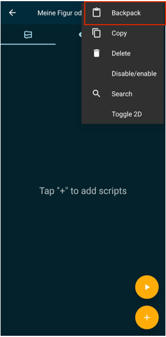

Η λειτουργία **σακίδιο** στο Pocket Code είναι μια πρακτική δυνατότητα που σε αφήνει να **αποθηκεύεις και να ξαναχρησιμοποιείς** στοιχεία, όπως χαρακτήρες (αντικείμενα), σενάρια, όψεις ή ήχους, **σε διαφορετικά έργα**. Σε βοηθά να κερδίζεις χρόνο και να κάνεις τα έργα σου πιο αποδοτικά.

Το σακίδιο είναι σαν έναν ψηφιακό χώρο αποθήκευσης όπου μπορείς να βάζεις διάφορα στοιχεία από το τρέχον έργο σου. Αφού τα αποθηκεύσεις στο σακίδιο, μπορείς να τα πάρεις και να τα βάλεις σε άλλα έργα.

### Πώς χρησιμοποιώ το σακίδιο για χαρακτήρες (αντικείμενα);

**Βάλε μορφές στο σακίδιο**

Πήγαινε στην προβολή του έργου από το οποίο θέλεις να βάλεις μια μορφή στο σακίδιο.

Πάτα τις τρεις τελείες δίπλα στη μορφή για να ανοίξεις το μενού και διάλεξε «Στο σακίδιο».

Η μορφή (μαζί με τις όψεις, τους ήχους και τα σενάριά της) θα μπει στο σακίδιο.

**Πρόσθεσε μορφές από το σακίδιο**

Άνοιξε το έργο στο οποίο θέλεις να βάλεις τη μορφή.

Στην προβολή του έργου, πάτα το σύμβολο + και διάλεξε «Σακίδιο».

Τώρα βλέπεις όλες τις μορφές και τα αντικείμενα που έχεις αποθηκεύσει στο σακίδιό σου. Πάτα τις τρεις τελείες και διάλεξε «Από το σακίδιο».

***

### Πώς χρησιμοποιώ το σακίδιο για σενάρια;

**Βάλε σενάρια στο σακίδιο:**

Πήγαινε στη μορφή που περιέχει το σενάριο. Κράτα πατημένο το σενάριο που θέλεις στον επεξεργαστή σεναρίων.

Διάλεξε «Προσθήκη στο σακίδιο» από το μενού.

Δώσε ένα όνομα στο σενάριο και επιβεβαίωσε με το OK.

Το σενάριο αποθηκεύεται και μπορεί να χρησιμοποιηθεί σε άλλα έργα.

**Πρόσθεσε σενάρια από το σακίδιο:**

Πάτα τον χαρακτήρα στον οποίο θέλεις να βάλεις το σενάριο. Θα δεις την περιοχή σεναρίων. Πάτα τις τρεις τελείες για να ανοίξεις το μενού και πάτα «Σακίδιο».

Τώρα βλέπεις όλα τα σενάρια που έχεις ήδη στο σακίδιό σου. Πάτα τις τρεις τελείες δίπλα στο σενάριο που θέλεις και διάλεξε «Από το σακίδιο» από το μενού.

Από το μενού μπορείς να διαγράψεις σενάρια που δεν χρειάζεσαι πια στο σακίδιό σου.

***

### Πλεονεκτήματα του σακιδίου

- **Επαναχρησιμοποίηση σε διαφορετικά έργα:** Οι μορφές, τα σενάρια, οι ήχοι και οι όψεις μπορούν να φτιαχτούν μία φορά και να χρησιμοποιηθούν όσες φορές χρειάζεσαι.
- **Εξοικονόμηση χρόνου:** Δεν χρειάζεται να φτιάχνεις ξανά μορφές ή σενάρια κάθε φορά.
- **Συνέπεια:** Τα στοιχεία μένουν τα ίδια όταν τα χρειάζεσαι σε πολλά έργα.
