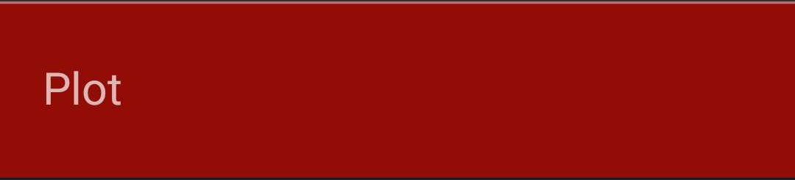
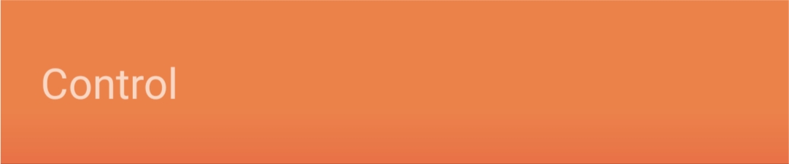

With Pocket Code you can program just by sticking bricks together. It is very easy to learn programming in this way! Here you can find information about what each block does and where can you use it.

**Select the brick category you want to find out more about!**

Programming doesn’t require typing code or memorizing complicated commands. We have prepared different blocks for you that you can simply put together. With these blocks you can build your program according to your ideas and control exactly what should happen on the screen.

The blocks are grouped into different categories according to their function, which then have the same color. For example, if you want to change the look of your object, the corresponding blocks are green. If you want to move your object, you’ll find the appropriate block in the “Motion” category which is blue.

All types of blocks you can use are listed here. Simply select the category that interests you and you will find an exact explanation.

