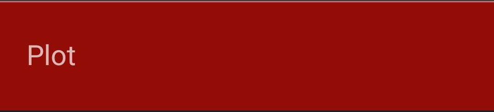

The Plot Bricks extension in Pocket Code allows you to create vector-based designs. With this extension, you can create SVG files that can be sent to a plotter to create drawings, cutting patterns, stickers, apply vinyl to T-shirts.

