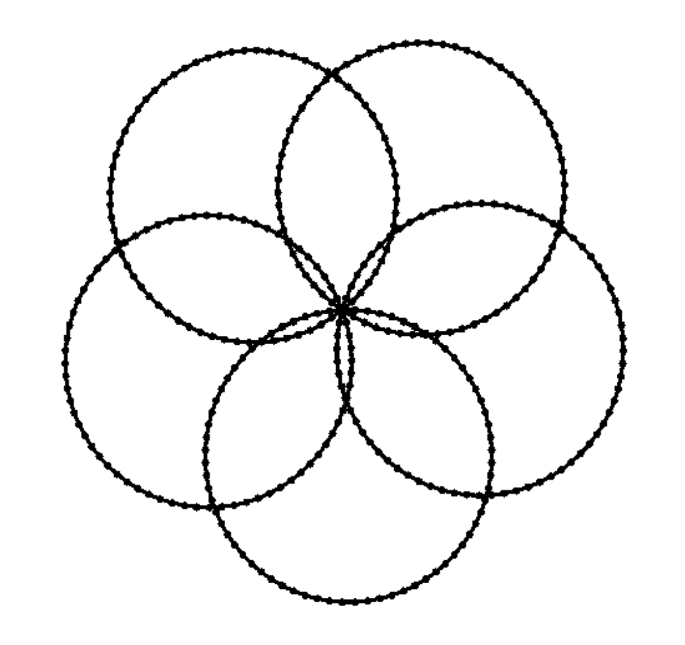

In this tutorial, you will learn how to embroider a flower (73 x 74.2mm).

You should already know what a loop is and how it works.

The **[Circle](../embroidery-tutorials-beginner/circle.md)**-tutorial may be helpful for this tutorial.

Take a look at the embroidery tutorials in the [Beginner](../embroidery-tutorials-beginner/index.md) series if you haven’t embroidered anything yet.

For more information or design suggestions check out the other tutorials.

*Here you can download the tutorial in PDF-format*:

[Flower](../../../media/embroidery-tutorials/Flower.pdf)

### 1. Create a new Embroidery-Object (see [Create Embroidery-Objects](../embroidery-tutorials-beginner/create-embroidery-objects.md)) and insert the following scripts:

### 2. Basic Structure

### 3. Circles

This part is called every time the circle message is sent. Add it to your script too.

### 4. Tap play to start your design!
