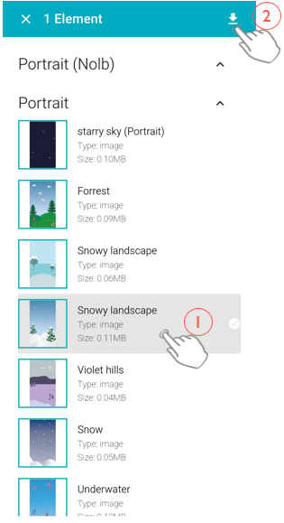

The Catrobat media library is a collection of **actors**, **backgrounds**, sounds, and objects that you can use in your projects. You can customize everything to fit your ideas!

[Actor](#add-a-new-actor-from-the-media-library)

[Background](#add-a-background-from-the-media-library)

[Sound](#add-a-sound-from-the-media-library)

[Object](#add-an-object-from-the-media-library)

***

### Add a new actor from the media library

In the project view, tap the + symbol [(more info](../quick-start-guide/add-actors-and-objects.md)) to add a new actor or object.

\
Select “Looks”.\
[Open image](../../../media/getting-started/NewActor-e1732794461668.jpg)

Choose an actor that you want to use in your program.

\
Tap on the actor (1) and download it (2).\
[Open image](../../../media/getting-started/grafik-19.png)

You can now give the actor a new name (1) and visually place it in your game (2). This means you can move your actor directly on the screen. You will immediately see where it is positioned in the project.

\
Confirm with “OK”.\
[Open image](../../../media/getting-started/grafik-29.png)

\
Place your actor (1) and confirm with the checkmark (2).\
[Open image](../../../media/getting-started/grafik-21.png)

***

### Add a background from the media library

Go to the background in the project view. Switch to the looks section and add a new look ([more info](../quick-start-guide/add-background.md)). Tap on “Looks.”

Choose a suitable background that you want to use in your program.

\
Tap on the background (1) and download it (2).\
[Open image](../../../media/getting-started/grafik-22.png)

***

### Add a sound from the media library

Sounds can be added to both your background and your actors or objects. Tap on the actor or background where you want to add the sound.

\
Go to the sound view and tap the + symbol.\
[Open image](../../../media/getting-started/grafik-23.png)

\
Tap on “Sounds” to access the media library.\
[Open image](../../../media/getting-started/grafik-30.png)

Choose a suitable sound that you want to use in your program.

\
Tap on the sound (1) and download it (2).\
[Open image](../../../media/getting-started/grafik-25.png)

***

### Add an object from the media library

Catrobat offers you the possibility to download ready-made objects. Objects are individual game elements such as a countdown, which already includes a script.

You add objects similar to actors.

In the project view, tap the + symbol ([more info](../quick-start-guide/add-actors-and-objects.md)) to add a new object.

\
Select “Library.”\
[Open image](../../../media/getting-started/NewActor-e1732794461668.jpg)

Search for an object you want to use in your program.

\
Tap on the object (1) and download it (2).\
[Open image](../../../media/getting-started/grafik-27.png)

You can now give the object a new name (1) and visually place it in your game (2). This means that you can move your object directly on the screen. You can immediately see where it stands in the project.

\
Confirm with “OK.”\
[Open image](../../../media/getting-started/grafik-29.png)

Place your object (1) and confirm with the check mark (2).
