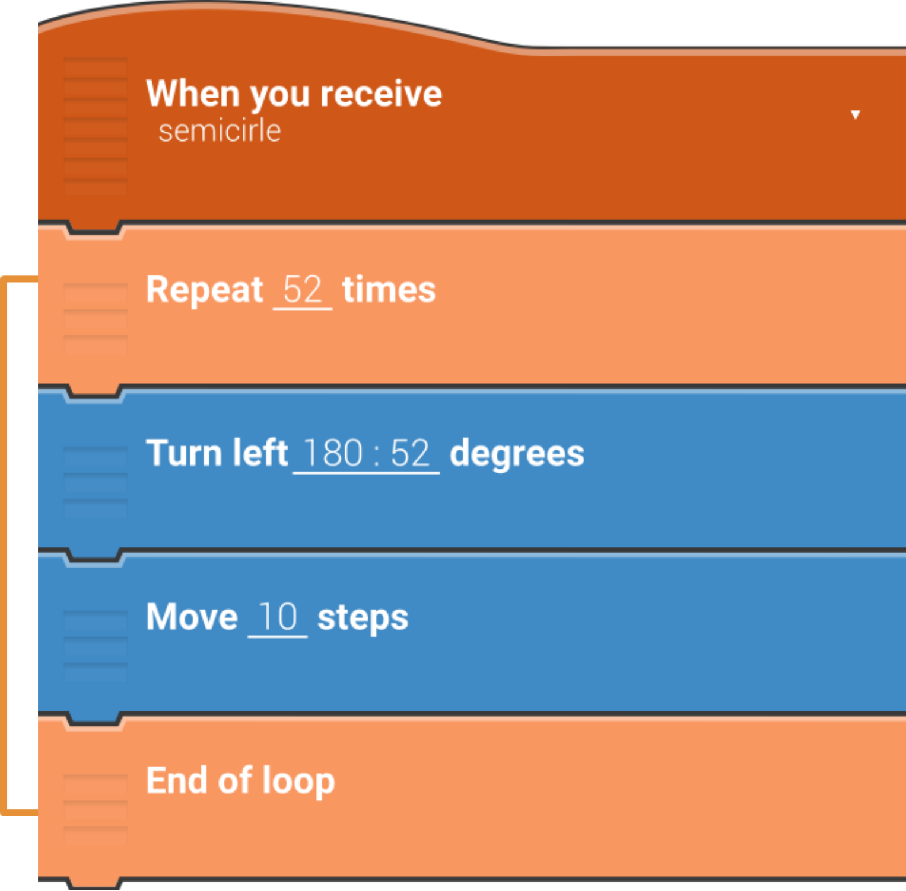

En este tutorial aprendes a bordar un corazón (103,6 x 112,8 mm).

Ya deberías saber qué es un bucle y cómo funciona.

El tutorial **[Semicírculo](../embroidery-tutorials-beginner/semicircle.md)** te puede ayudar con este tutorial.

Si todavía no has bordado nada, mira los tutoriales de bordado de la serie [Principiantes](../embroidery-tutorials-beginner/index.md).

Si quieres más información o ideas para diseños, mira los otros tutoriales.

*Aquí puedes descargar el tutorial en PDF*:

[Corazón](../../../media/embroidery-tutorials/Heart.pdf)

### 1. Crea un objeto de bordado nuevo (mira [Crear objetos de bordado](../embroidery-tutorials-beginner/create-embroidery-objects.md)) y pon estos scripts:

### 2. Estructura básica

### 3. Semicírculos

Esta parte se ejecuta cada vez que se envía el mensaje del semicírculo. Añádela también a tu script.

### 4. ¡Toca play para iniciar tu diseño!
