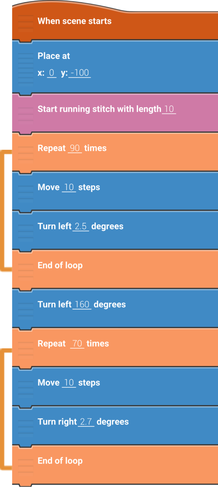

En este tutorial aprendes a bordar un cielo nocturno (48,5 x 96,1 mm).

Ya deberías saber qué es un bucle y cómo funciona.

El tutorial **[Estrella](../embroidery-tutorials-beginner/star.md)** te puede ayudar con este tutorial.

También te ayuda si ya sabes usar la función de enviar mensajes.

Si todavía no has bordado nada, mira los tutoriales de bordado de la serie [Principiantes](../embroidery-tutorials-beginner/index.md).

Si quieres más información o ideas para diseños, mira los otros tutoriales.

*Aquí puedes descargar el tutorial en PDF*:

[Cielo nocturno](../../../media/embroidery-tutorials/Night-Sky.pdf)

### 1. Crea un objeto de bordado nuevo (mira [Crear objetos de bordado](../embroidery-tutorials-beginner/create-embroidery-objects.md)) y pon estos scripts:

### 2. Luna

### 3. Una estrella

Esta parte se ejecuta cada vez que se envía el mensaje del semicírculo. Añádela también a tu script.

### 4. Todas las estrellas

### 5. ¡Toca play para iniciar tu diseño!
