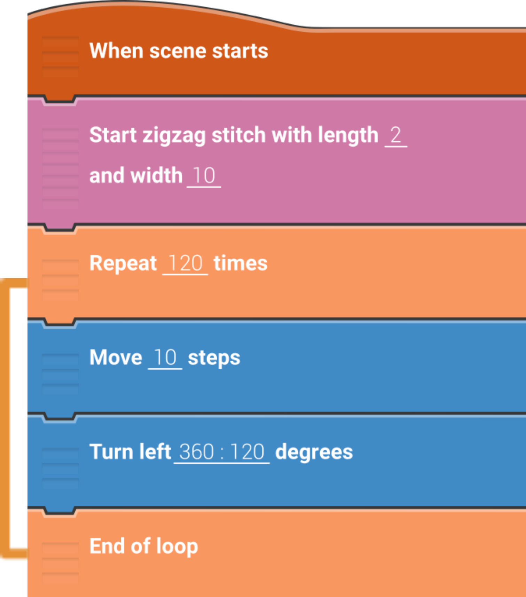

En este tutorial aprendes a bordar el Yin y el Yang (78,4 x 78,4 mm).

Ya deberías saber qué es un bucle y cómo funciona.

El tutorial **[Círculo](../embroidery-tutorials-beginner/circle.md)** te puede ayudar con este tutorial.

Si todavía no has bordado nada, mira los tutoriales de bordado de la serie [Principiantes](../embroidery-tutorials-beginner/index.md).

Si quieres más información o ideas para diseños, mira los otros tutoriales.

*Aquí puedes descargar el tutorial en PDF*:

[Yin y Yang](../../../media/embroidery-tutorials/Yin-and-Yang.pdf)

### 1. Crea un objeto de bordado nuevo (mira [Crear objetos de bordado](../embroidery-tutorials-beginner/create-embroidery-objects.md)):

### 2. Pon este script para el círculo grande:

### 3. Curva del medio

Añade también esta parte a tu script:

### 4. Círculo pequeño de arriba

Crea un objeto de bordado nuevo y pon este script:

### 5. Copiar el círculo pequeño

Puedes copiar el objeto del paso 4:

### 6. Círculo pequeño de abajo

Tienes que cambiar la posición del segundo círculo:

### 7. ¡Toca play para iniciar tu diseño!
