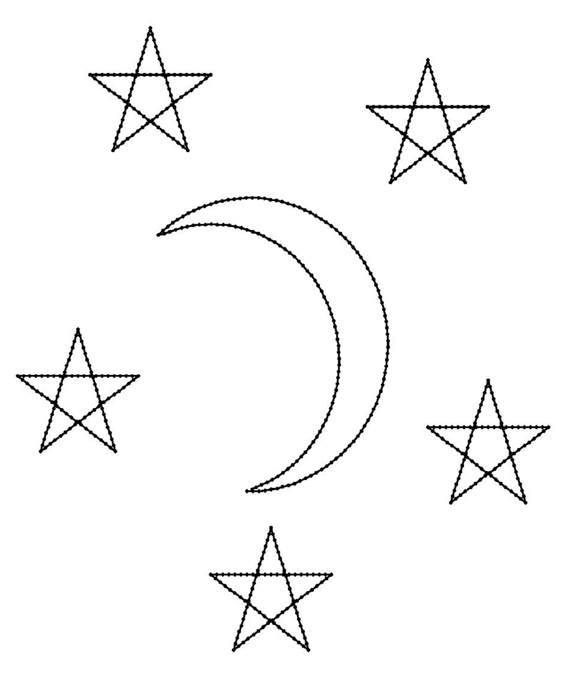

Tutorial honetan, gaueko zeruari (48,5 x 96,1 mm) bordatzen ikasiko duzu.

Jakin beharko zenuke zer den buelta bat eta nola funtzionatzen duen.

**[Izarra](../embroidery-tutorials-beginner/star.md)** tutoriala lagungarria izan daiteke.

Era berean, lagungarria da dagoeneko telebista-saioa ezagutzen baduzu.

Begiratu sorta honetako bordatu-tutorialak [Hasiberriak](../embroidery-tutorials-beginner/index.md) oraindik ez baduzu bordatu.

Informazio gehiago edo diseinu-aholkuak beste tutorialetan ikus daitezke.

*Hemen, tutoriala deskarga dezakezu PDF formatua*:

[Gaueko Zerua](../../../media/embroidery-tutorials/Night-Sky.pdf)

### 1. Sortu objektu bordatu berri bat (ikus [Sortu ehungintza objektuak](../embroidery-tutorials-beginner/create-embroidery-objects.md)) eta sartu script hauek:

### 2. Ilargia

### 3. Izar bat

Parte hau izar mezuak bidaltzen dituen bakoitzean deitzen da. Zure gidoian ere gehitu.

### 4. Izar guztiak

### 5. Sakatu jolasera eta diseinua hasiko da!
