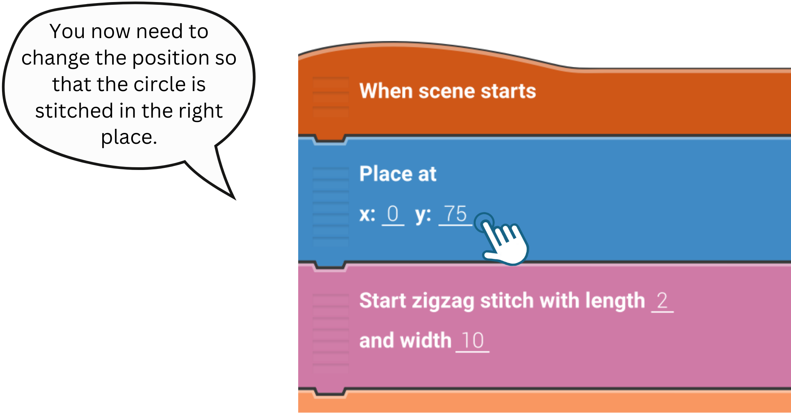

Tutorial honetan, ikasiko duzu nola bordatu Yin eta Yang (78,4 x 78,4 mm).

Jakin beharko zenuke zer den buelta bat eta nola funtzionatzen duen.

**[Zirkulu bat](../embroidery-tutorials-beginner/circle.md)** tutoriala lagungarria izan daiteke.

Begiratu sorta honetako bordatu-tutorialak [Hasiberriak](../embroidery-tutorials-beginner/index.md) oraindik ez baduzu bordatu.

Informazio gehiago edo diseinu-aholkuak beste tutorialetan ikus daitezke.

*Hemen, tutoriala deskarga dezakezu PDF formatua*:

[Yin eta Yang](../../../media/embroidery-tutorials/Yin-and-Yang.pdf)

### 1. Sortu objektu bordatu berria (ikus [Sortu ehungintza objektuak](../embroidery-tutorials-beginner/create-embroidery-objects.md)):

### 2. Sartu hurrengo eskritura zirkulu handiarentzat:

### 3. Erdialdeko kurba

Zure gidoian ere gehitu:

### 4. Txiki-txikia

Sortu josteko objektu berria eta sartu eskritura hau:

### 5. Errepikatu Zirkulu Txikia

Objektua kopiatu dezakezu 4. urratsetik:

### 6. Zirkulu txikia beheko aldean

Bigarren zirkuluaren posizioa aldatu behar da:

### 7. Sakatu jolasera eta diseinua hasiko da!
