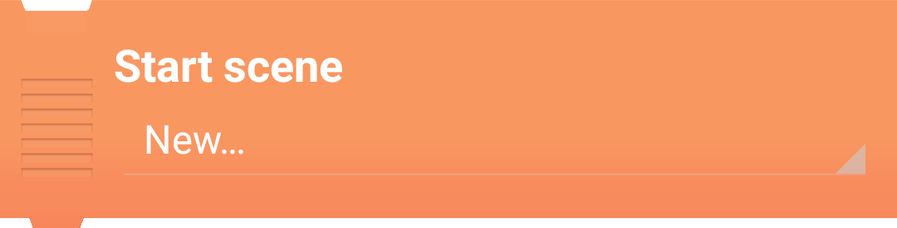

این بلاک کود به صحنه ای متفاوت در پروژه شما تغییر می کند و شروع به اجرا کردن آن صحنه از ابتدا می کند. مثل تغییر فصل در یک کتاب یا حرکت به سطح بعدی در یک بازی است.

تصور کنید که صحنه های متعددی در پروژه تان دارید، هر کدام بخش متفاوتی از داستان یا بازی شما را نشان می دهند. با استفاده از این بلاک کود، می‌توانی به هر صحنه ای حرکت کنید و آن را از همان ابتدا شروع کنید، ایجاد یک انتقال منظم بین بخش های مختلف پروژه خود.
