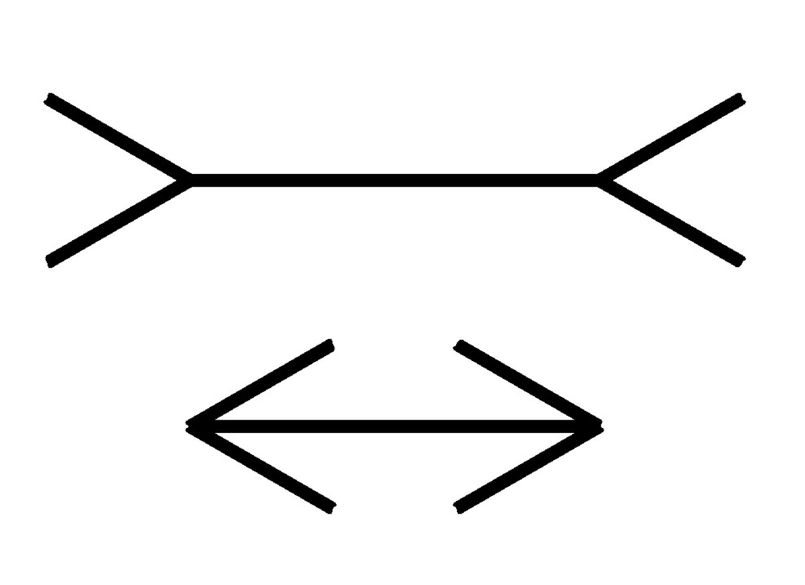

در این آموزش یاد می‌گیری چطور یک توهم نوری را گلدوزی کنی (۱۰۱٫۸ × ۱۷۰٫۲ میلی‌متر).

اگر هنوز چیزی گلدوزی نکرده‌ای، آموزش‌های سری [مبتدی](../embroidery-tutorials-beginner/index.md) را ببین.

برای اطلاعات بیشتر یا ایده‌های طراحی، آموزش‌های دیگر را ببین.

*اگر بخواهی آموزش را به شکل PDF دانلود کنی*:

[توهم نوری](../../../media/embroidery-tutorials/Optical-Illusion.pdf)

### ۱. یک شیء گلدوزی جدید بساز (ببین [ساخت شیء گلدوزی](../embroidery-tutorials-beginner/create-embroidery-objects.md)) و اسکریپت‌های زیر را اضافه کن:

### ۲. شکل اول:

### ۳. شکل دوم

### ۴. روی اجرا ضربه بزن تا طرحت شروع شود!
